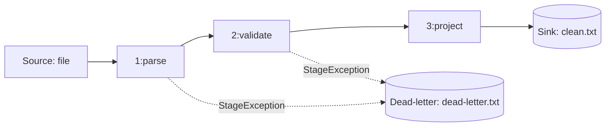

# LogFlow Mimari Belgesi

## 1. Genel Bakış

LogFlow, log satırlarını şu akışla işler:

```
Source (satır okur) → Stage 1 (parse) → Stage 2..N (filter, project) → Sink (yazar)
```

Artış 4 ile pipeline'ın **topolojisi** (hangi kaynak, hangi aşamalar, hangi hedef)
koddan çıkarılıp YAML yapılandırma dosyasına taşınmıştır. Böylece mimarinin
**tanımı** (YAML) ile **gerçekleştirimi** (C# sınıfları) birbirinden ayrılmıştır.
Yeni bir pipeline kurmak için dosya yazmak yeterlidir, yeniden derleme gerekmez.

## 2. Yapılandırma Şeması

```yaml
pipeline:
  name: <metin>          # isteğe bağlı, varsayılan "unnamed"
  source:                # zorunlu
    type: <kaynak türü>
    params: { ... }
  stages:                # zorunlu, en az 1 eleman; ilk aşama "parse" olmalı
    - type: <aşama türü>
      params: { ... }
  sink:                  # zorunlu
    type: <hedef türü>
    params: { ... }
```

Her bileşen (`source`, her `stage`, `sink`) iki alandan oluşur:
`type` (hangi bileşen) ve `params` (o bileşenin parametreleri).

### 2.1 Kayıtlı bileşenler

| Rol | type | Sınıf | Parametreler |
|---|---|---|---|
| source | `file` | `FileLineSource` | `path`: metin, zorunlu, dosya mevcut olmalı |
| stage | `parse` | `ParserStage` | `format`: `clf` veya `custom`, zorunlu |
| stage | `filter` | `FilterStage` | `field`, `op`, `value`: hepsi zorunlu |
| stage | `project` | `ProjectionStage` | `fields`: liste, zorunlu, boş olamaz |
| sink | `file` | `FileSink` | `path`: metin, zorunlu |

### 2.2 `filter` ayrıntısı

| Alan türü | Alanlar | Geçerli `op` değerleri | `value` türü |
|---|---|---|---|
| Sayısal | `status`, `bytes` | `==`, `!=`, `>`, `>=`, `<`, `<=` | tamsayı |
| Metin | `clientIp`, `method`, `path`, `userAgent` | `==`, `!=`, `startsWith`, `contains` | metin |

YAML'da `>`, `>=` gibi operatörler **tırnak içinde** yazılmalıdır: `op: ">="`.

### 2.3 `project` için geçerli alanlar
`timestamp`, `clientIp`, `method`, `path`, `status`, `bytes`, `userAgent`

### 2.4 Örnek (hata raporu)

```yaml
pipeline:
  name: error-report
  source:
    type: file
    params: { path: data/access.log }
  stages:
    - type: parse
      params: { format: clf }
    - type: filter
      params: { field: status, op: ">=", value: 400 }
    - type: project
      params: { fields: [timestamp, clientIp, status, path] }
  sink:
    type: file
    params: { path: out/errors.txt }
```

## 3. Aşama Kayıt Sistemi (Registry)

YAML'daki `type: filter` yazısını `FilterStage` sınıfına çeviren mekanizma:

- Her bileşen sınıfı bir öznitelikle işaretlenir: `[Source("ad")]`,
  `[Stage("ad")]` veya `[Sink("ad")]` (`ComponentAttributes.cs`).
- `ComponentRegistry.Discover(assembly)`, program başlarken **reflection** ile
  assembly'yi tarar ve (rol, ad) → sınıf tablosunu otomatik doldurur.
- Hiçbir yerde sabit kodlanmış `switch` yoktur; kayıt **veri odaklıdır**.
- Her bileşen `ParamReader` alan bir kurucu sunar ve kendi parametrelerini
  kendisi doğrular.
- Aynı ad iki sınıfta kullanılırsa başlangıçta hata verilir.

**Yeni aşama eklemek:**
1. Yeni sınıf yaz, `IStage<LogRecord, LogRecord>` uygula.
2. Üstüne `[Stage("yeniad")]` ekle.
3. `ParamReader` alan bir kurucu yaz, parametreleri orada doğrula.

Başka hiçbir dosya değişmez (Open/Closed ilkesi).

## 4. Yükleme Akışı (PipelineLoader)

1. YAML okunur ve `PipelineFile` nesnesine dönüştürülür (YamlDotNet).
2. Yapısal kontrol: `source`, `sink` ve en az bir `stage` var mı?
3. Her bileşen registry üzerinden oluşturulur; parametre doğrulaması kurucuda
   yapılır (`ParamReader`: eksik parametre, yanlış tür, geçersiz değer).
4. Tip zinciri kontrolü: ilk aşama `string → LogRecord` (parse), sonrakiler
   `LogRecord → LogRecord` olmalı; sink `LogRecord` kabul etmeli.
5. Her şey geçerliyse `Pipeline` nesnesi döner. `Run()` **ancak bundan sonra**
   çağrılır.

Tüm bileşenler `Run()`'dan önce oluşturulduğu için yapılandırma hataları
daima veri işlenmeden önce ortaya çıkar.

## 5. Hata Politikası

| | Yapılandırma zamanı hatası | Çalışma zamanı veri hatası |
|---|---|---|
| Örnek | bilinmeyen tür, eksik parametre, yanlış tür | bozuk log satırı |
| Ne zaman | veri okunmadan önce | satır işlenirken |
| Davranış | `ConfigException`, açık mesaj, çıkış kodu 1 (**fail fast, fail loudly**) | satır sayılıp atlanır (5. hafta konusu) |

## 6. Bileşen Haritası

| Dosya | Sorumluluk |
|---|---|
| `Interfaces.cs` | `ISource`, `IStage`, `ISink`, `IEmitter` sözleşmeleri |
| `ComponentAttributes.cs` | `[Source]`, `[Stage]`, `[Sink]` öznitelikleri |
| `ComponentRegistry.cs` | Reflection ile bileşen keşfi ve oluşturma |
| `ParamReader.cs` | Parametre okuma, tür ve varlık doğrulama |
| `PipelineConfig.cs` | YAML'ın C# veri modeli |
| `PipelineLoader.cs` | YAML → doğrulanmış `Pipeline` |
| `Pipeline.cs` | Çalıştırma (Open → akış → Close) |
| `ConfigException.cs` | Yapılandırma zamanı hata türü |
| `Program.cs` | `--config` argümanını okur, yükler, çalıştırır |


## 7. Hata Modeli (Artırım 5)

| | `StageException` | `PipelineException` |
|---|---|---|
| Anlamı | Tek bir kayıt bir aşamada işlenemedi | Hat devam edemez |
| Kurtarılabilir mi? | Evet, aşamanın hata politikası karar verir | Hayır, çalıştırma durur |
| Örnekler | Kesik satır, negatif bytes, geçersiz tarih | Yapılandırma hatası (`ConfigException`), okunamayan kaynak, disk dolu, dead-letter yazılamıyor |
| Kim fırlatır | Aşamalar (`ParserStage`, `ValidationStage`) | Loader, kaynak, hedefler, `Pipeline` |
| Çıkış kodu | politikaya bağlı | 1 (config) / 3 (çalışma) |

`ConfigException`, `PipelineException`'ın alt türüdür.

## 8. Hata Politikaları
Her aşamada `onError` ile seçilir (varsayılan `FAIL_FAST`).

| Politika | Davranış |
|---|---|
| `FAIL_FAST` | Çalıştırmayı durdurur (`PipelineException`) |
| `SKIP` | Kaydı atlar, aşama sayacına işler |
| `DEAD_LETTER` | `FailedRecord(rawInput, stageName, exception, timestamp)` oluşturup dead-letter hedefine yollar |
| `RETRY(n)` | Aşamayı n kez daha dener; hâlâ başarısızsa `FAIL_FAST` gibi davranır (6. hafta I/O aşamaları için) |

## 9. Hat Topolojisi (düz çizgi değil)



Ana hat ile dead-letter hattı bağımsızdır. Hata yönlendirmesi bir topoloji
kararıdır ve config'te seçilir, `catch` bloğunda değil.

## 10. RunSummary
Gelen, çıkan, aşama başına giren/çıkan/filtrelenen/atlanan/dead-letter/retry,
aşama başına süre ve toplam süre. Değişmez kural:
`Gelen = Çıkan + Filtrelenen + Atlanan + DeadLetter`. Tutmazsa çıkış kodu 4.
`#` ile başlayan yorum satırları kaynakta atlanır ve kayıt sayılmaz.

## 11. Kaos Testi: Hata Türü → Politika (`data/access-dirty.log`)

| Hata türü | Yakalayan aşama | Politika | Sonuç |
|---|---|---|---|
| Kesik satır (zaman damgası yarım) | `parse` | DEAD_LETTER | dead-letter.txt |
| Kesik satır (boyut alanı yok) | `parse` | DEAD_LETTER | dead-letter.txt |
| UTF-8 olmayan baytlar | `parse` | DEAD_LETTER | dead-letter.txt |
| 100 KiB'lık tek satır | `parse` (`maxLineLength`) | DEAD_LETTER | dead-letter.txt (ham satır 200 karaktere kısaltılır) |
| Negatif bytes (-45) | `validate` (`bytesMin`) | DEAD_LETTER | dead-letter.txt |
| 1970 zaman damgası | `validate` (`minYear`) | DEAD_LETTER | dead-letter.txt |
| 2099 zaman damgası | `validate` (`maxYear`) | DEAD_LETTER | dead-letter.txt |
| Yorum satırı (#) | kaynak | kayıt sayılmaz | - |
| Boş dosya | - | hata değil | 0 kayıt, özet 0 = 0 |
| Okunamayan kaynak | kaynak | `PipelineException` | durur, çıkış kodu 3 |
| Disk dolu | sink / dead-letter | `PipelineException` | durur, çıkış kodu 3 |

Sonuç: 10 gelen = 3 çıkan + 7 dead-letter.